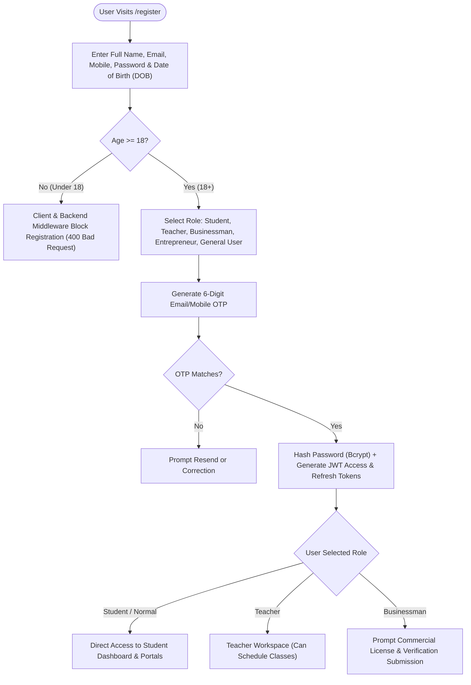
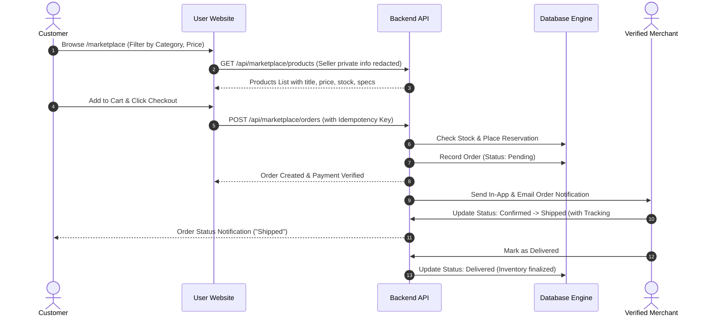
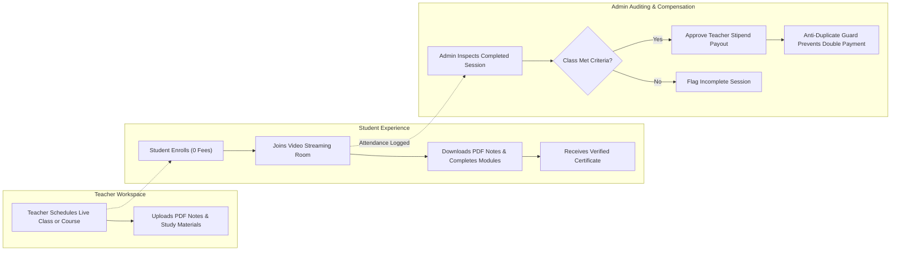
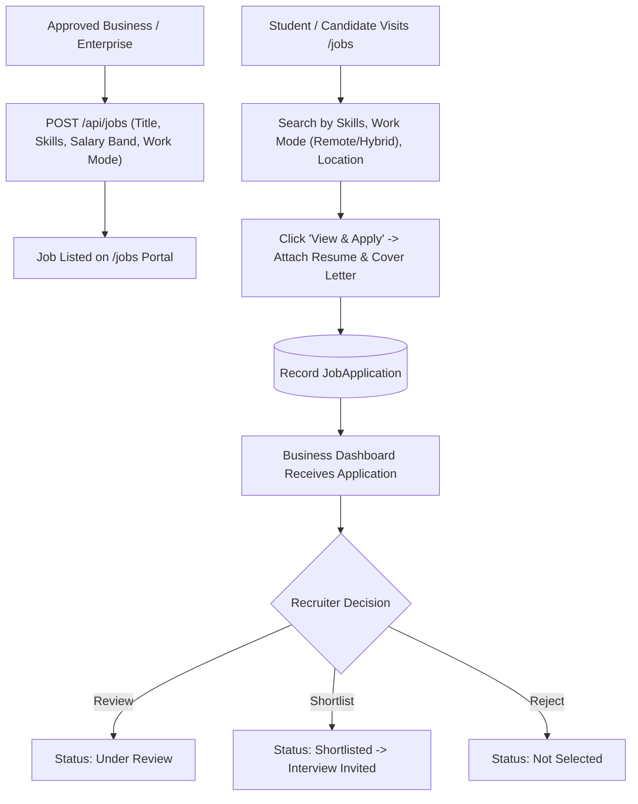
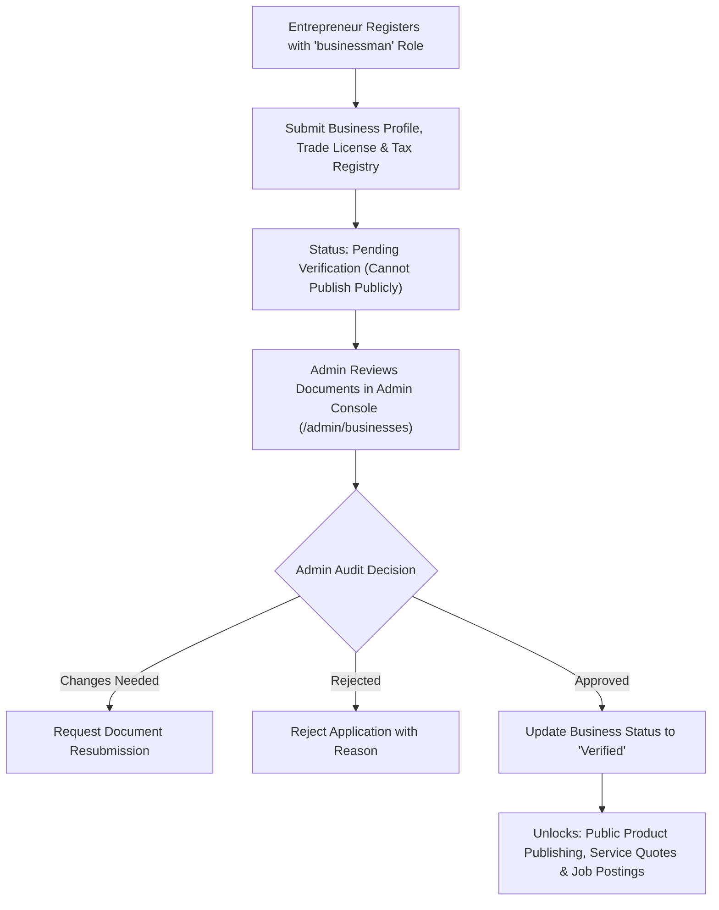
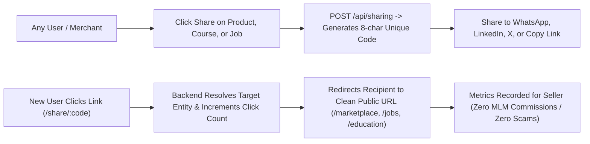

# Business Hub: Platform Concepts, Architecture & End-to-End Workflows

> **Unified MERN Stack Enterprise SaaS Platform**  
> *Commerce, 100% Free Education, Verified Recruitment, Community Networking, and Live Events in One Seamless Ecosystem.*

---

## 1. Executive Summary & Core Concepts

**Business Hub** is a multi-tenant digital ecosystem uniting five primary verticals into a single cohesive platform:

1. **Multi-Vendor Marketplace**: Hardware, electronics, office supplies, gadgets, and verified professional consulting services.
2. **Free Education & Live Classrooms**: 100% free certified courses, real-time video streaming classrooms, downloadable study notes, and tuition.
3. **Verified Corporate Job Board**: Direct job postings from verified enterprises with internal resume submission and application tracking.
4. **Community Knowledge Circles**: Spam-free peer discussion hubs spanning engineering, commerce, study pods, and career development.
5. **Interactive Live Events & Masterclasses**: Real-time workshops, business summits, virtual job fairs, and live classroom sessions.
6. **Clean Social Link Sharing**: Privacy-preserving link generation and click attribution with zero MLM commission wallets or pyramid schemes.

### Three Foundational Principles

| Principle | Rule & Architectural Enforcement |
| :--- | :--- |
| **1. Strict Seller Privacy** | Public marketplace views, search APIs, and shared links **never** expose owner personal names, personal mobile numbers, or residential addresses. Legal identity documents are accessible exclusively to compliance administrators. |
| **2. 100% Free Education** | Students are never charged tuition fees, paywalls, or trial expirations. Educators are fairly compensated through platform/admin stipends upon verified class completion. |
| **3. Ethical Clean Sharing** | Users generate privacy-safe links with click attribution for products, courses, and jobs. No affiliate cuts, pyramid schemes, or financial MLM wallets. |

---

## 2. Multi-Role Ecosystem & User Personas

Business Hub enforces strict **Role-Based Access Control (RBAC)** alongside a mandatory **18+ Date of Birth (DOB) validation** during onboarding.

```
                                  ┌────────────────────────┐
                                  │      ALL USERS         │
                                  │   (Must be Age 18+)    │
                                  └───────────┬────────────┘
                                              │
              ┌───────────────────┬───────────┴───────────┬───────────────────┐
              ▼                   ▼                       ▼                   ▼
        [ 👑 ADMIN ]        [ 🎓 TEACHER ]       [ 🏢 BUSINESSMAN ]     [ 📚 STUDENT ]
      Central Oversight    Class Authoring &     Storefronts, Orders   Free Learning &
      Audits & Approvals   Live Rooms Hosting     & Job Publishing      Job Applying
```

### Role Matrix

| Persona | Primary Goal | Core Capabilities | Default Portal / Workspace |
| :--- | :--- | :--- | :--- |
| **👑 Admin** | Platform Governance & Security | Audits business documentation, approves teacher compensation stipends, monitors platform audit logs, inspects system metrics. | Admin Control Center (`localhost:3001` / `/dashboard/admin`) |
| **🏢 Businessman / Entrepreneur** | Commerce, Selling & Recruitment | Sets up digital storefronts, manages product variants, submits service quotes, fulfills orders, posts verified jobs. | Business Portal (`/business`, `/dashboard/business`) |
| **🎓 Teacher** | Educational Content & Live Mentorship | Publishes free courses, schedules WebRTC live video classrooms, uploads PDF study notes, tracks stipend approvals. | Teacher Portal (`/teacher`, `/dashboard/teacher`) |
| **📚 Student** | Skill Building & Career Advancement | Enrolls in free certified courses, joins live streaming classrooms, downloads study notes, applies for jobs. | Student Dashboard (`/education`, `/dashboard/student`) |
| **👤 General User** | Shopping & Discovery | Purchases products, browses services and career opportunities, generates clean share links. | Public Portals (`/marketplace`, `/jobs`, `/cart`) |

---

## 3. End-to-End System Workflows

### 3.1 Workflow 1: Authentication & 18+ Age Validation

Enforces age eligibility and multi-factor verification before granting access to role workspaces.



---

### 3.2 Workflow 2: Marketplace Order & Fulfillment Lifecycle

Includes stock reservation, seller privacy redaction, and idempotent checkout processing.



---

### 3.3 Workflow 3: 100% Free Education & Teacher Stipend Compensation

Students enjoy complete zero-cost learning; instructors are reimbursed through audited platform disbursements.



---

### 3.4 Workflow 4: Verified Job Posting & Recruitment Pipeline

Only verified commercial entities are permitted to list vacancies, protecting candidates from phantom job solicitations.



---

### 3.5 Workflow 5: Business Verification & Merchant Onboarding

Rigorous verification ensures platform credibility and customer protection.



---

### 3.6 Workflow 6: Clean Link Sharing & Referral Attribution

Permits organic discovery across social channels while prohibiting MLM pyramid compensation structures.



---

## 4. The 6 Explore Portals & Frontend Routing

The user-facing navigation provides direct, intuitive access to all key modules:

```
[ B Business Hub ]       Home  |  Explore ▼  |  About       [🔍 Search]  [🔔 2]  [ Login ]
```

Inside the **Explore** dropdown, six dedicated landing pages are featured:

| Portal | Route | Primary Audience | Core Value Proposition |
| :--- | :--- | :--- | :--- |
| **1. Marketplace** | `/marketplace` | Buyers & Merchants | Enterprise workstations, gadgets, and verified services with mandatory seller identity privacy and 0% commission fees. |
| **2. Education** | `/education` | Students & Learners | 100% free courses, interactive live video streaming classrooms, downloadable study notes, and 1-on-1 tuition. |
| **3. Jobs & Careers** | `/jobs` | Job Seekers & Freshers | Direct hiring by verified corporate employers with transparent salary bands and internal application tracking. |
| **4. Business** | `/business` | Merchants & Founders | Digital storefronts, multi-variant inventory management, order fulfillment tracking, and corporate recruiting. |
| **5. Community** | `/community` | All Users & Mentors | Spam-free discussion circles (Engineering, Commerce, Study Pods, Careers) for collaborative peer growth. |
| **6. Events** | `/events` | Attendees & Speakers | Real-time interactive masterclasses, virtual corporate summits, tech career hiring fairs, and live workshops. |

---

## 5. Technology Architecture & Monorepo Organization

The project is structured as a full-stack monorepo:

```
Business_Hub_2/
├── backend/                      # Unified Express/Node.js API (Port 5000)
│   ├── src/config/               # Database connectors & environment config
│   ├── src/middleware/           # JWT Auth, RBAC, 18+ DOB check, Audit logging
│   ├── src/modules/
│   │   ├── auth/                 # Registration, login, OTP verification, password reset
│   │   ├── users/                # User accounts, role switching, permissions
│   │   ├── business/             # Trade license filings & verification
│   │   ├── marketplace/          # Products, services, cart, orders, checkout
│   │   ├── education/            # Courses, live classes, study notes, tuition
│   │   ├── jobs/                 # Vacancies & candidate applications
│   │   ├── sharing/              # Privacy-preserving shareable links
│   │   ├── admin/                # Platform KPIs, approvals, audit logs
│   │   └── notifications/        # User and business alert notifications
│   └── src/server.ts             # Express bootstrap on port 5000
│
├── user-website/                 # Main Public & Customer Web Application (Port 3000)
│   ├── src/components/layout/    # Navbar.tsx, Footer.tsx
│   ├── src/components/common/    # Breadcrumb.tsx
│   ├── src/pages/landing/        # LandingPage.tsx (Homepage)
│   ├── src/pages/marketplace/    # MarketplacePage.tsx, ProductDetailPage.tsx, CartPage.tsx
│   ├── src/pages/education/      # EducationPage.tsx, CourseDetailPage.tsx, LiveClassesPage.tsx
│   ├── src/pages/jobs/           # JobsPage.tsx, JobDetailPage.tsx
│   ├── src/pages/business/       # BusinessDetailsPage.tsx, BusinessDashboardPage.tsx
│   ├── src/pages/community/      # CommunityPage.tsx
│   ├── src/pages/events/         # EventsPage.tsx
│   ├── src/pages/student/        # StudentDashboardPage.tsx
│   ├── src/pages/teacher/        # TeacherDetailsPage.tsx, TeacherDashboardPage.tsx
│   └── src/routes/AppRoutes.tsx  # React Router v6 route configuration
│
└── admin-website/                # High-Security Admin Control Panel (Port 3001)
    ├── src/pages/businesses/     # Business verification & compliance audits
    ├── src/pages/teachers/       # Teacher compensation review & stipend disbursements
    ├── src/pages/audit/          # Immutable system audit trail logs
    └── src/pages/dashboard/      # Aggregate system metrics, KPIs & user management
```

---

## 6. Security, Compliance & Data Governance

1. **Password Security**: Passwords hashed using Bcrypt with a minimum of 10 salt rounds.
2. **Session Integrity**: Stateless JWT authentication with access and refresh tokens, coupled with HTTP-only cookies and Authorization bearer headers.
3. **Data Redaction**: Sensitive personal identifiable information (PII) of business owners is stripped before payload delivery on public endpoints.
4. **Idempotent Transactions**: Unique client idempotency keys prevent duplicate order creation, double callbacks, or inventory inconsistencies.
5. **Audit Logging**: Sensitive administrative actions (approving businesses, issuing teacher stipends, banning accounts) generate immutable audit records.
